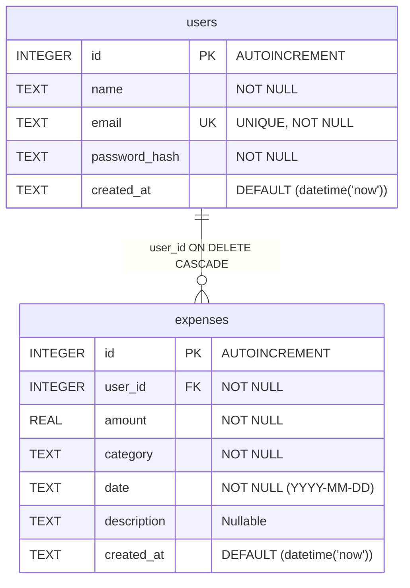

# Step 1 — SQLite Database Implementation Plan

Based strictly on [.agents/specs/01-database-setup.md](file:///Users/arpitkushwaha/Documents/Github%20Projects/Agentic%20Coding%20/expense-tracker/.agents/specs/01-database-setup.md), [database/db.py](file:///Users/arpitkushwaha/Documents/Github%20Projects/Agentic%20Coding%20/expense-tracker/database/db.py), [app.py](file:///Users/arpitkushwaha/Documents/Github%20Projects/Agentic%20Coding%20/expense-tracker/app.py), and [AGENTS.md](file:///Users/arpitkushwaha/Documents/Github%20Projects/Agentic%20Coding%20/expense-tracker/AGENTS.md).

## Goal Description

Replace the 5-line stub in [database/db.py](file:///Users/arpitkushwaha/Documents/Github%20Projects/Agentic%20Coding%20/expense-tracker/database/db.py) with a working SQLite3 data layer (`get_db()`, `init_db()`, `seed_db()`) backed by `spendly.db` in the project root, and wire `init_db()` and `seed_db()` into [app.py](file:///Users/arpitkushwaha/Documents/Github%20Projects/Agentic%20Coding%20/expense-tracker/app.py) within `app.app_context()` so the database is automatically initialized and seeded before serving requests.

---

## User Review Required

> [!IMPORTANT]
> **Strict File Modification Scope**
> Per Section 4 of the specification, implementation will modify **only** `database/db.py` and `app.py`, and will **not create any new files** (no test files, migration scripts, or template/CSS edits). Verification will be run via inline Python checks against `.venv/bin/python`.

> [!NOTE]
> **Database Filename vs. `.gitignore`**
> Section 5 requires the database file to be `spendly.db` in the project root (`expense-tracker/spendly.db`), whereas [.gitignore](file:///Users/arpitkushwaha/Documents/Github%20Projects/Agentic%20Coding%20/expense-tracker/.gitignore) currently ignores `expense_tracker.db`. Because only `database/db.py` and `app.py` may be modified in Step 1, `.gitignore` will remain untouched and `spendly.db` will appear as untracked in `git status` once generated unless ignored later.

> [!NOTE]
> **SQLite `DEFAULT` Timestamp Syntax**
> Section 6 specifies `DEFAULT datetime('now')` for `created_at`. In SQLite DDL, non-constant expressions in `DEFAULT` must be parenthesized as `DEFAULT (datetime('now'))` to avoid a syntax error. Both tables will use `TEXT DEFAULT (datetime('now'))`.

---

## Schema & Data Flow



---

## Proposed Changes

### Database Layer (`database/db.py`)

Implement SQLite connection management, schema initialization, and idempotent demo data seeding using only Python's standard-library `sqlite3` (plus `os`/`datetime`) and `werkzeug.security.generate_password_hash`.

#### [MODIFY] [db.py](file:///Users/arpitkushwaha/Documents/Github%20Projects/Agentic%20Coding%20/expense-tracker/database/db.py)

Key implementation details:
1. **Project-root DB path (`DB_PATH`)**:
   - Compute `os.path.join(os.path.dirname(os.path.dirname(os.path.abspath(__file__))), "spendly.db")` so `spendly.db` always resolves to the `expense-tracker/` root regardless of current working directory.
2. **`get_db()`**:
   - Open `sqlite3.connect(DB_PATH)`.
   - Set `conn.row_factory = sqlite3.Row`.
   - Execute `conn.execute("PRAGMA foreign_keys = ON")` on every connection.
   - Return `conn`.
3. **`init_db()`**:
   - Obtain connection via `get_db()`, execute `CREATE TABLE IF NOT EXISTS users (...)` and `CREATE TABLE IF NOT EXISTS expenses (...)` with `FOREIGN KEY (user_id) REFERENCES users (id) ON DELETE CASCADE`, commit, and close in a `try ... finally` block.
4. **`seed_db()`**:
   - Obtain connection via `get_db()`.
   - Check `SELECT 1 FROM users LIMIT 1`; if any row exists, return immediately.
   - Insert demo user (`Demo User`, `demo@spendly.com`, `generate_password_hash("demo123")`) using parameterized `?` placeholders and capture `cursor.lastrowid`.
   - Build 8 sample expense tuples linked to `user_id` covering all 7 fixed categories (`Food`, `Transport`, `Bills`, `Health`, `Entertainment`, `Shopping`, `Other`) plus 1 extra `Food` expense, with `YYYY-MM-DD` dates in the current month (`date.today().replace(day=d).isoformat()` using safe days `1, 4, 7, 10, 14, 17, 21, 25` valid across all months), realistic INR amounts (`REAL`), and descriptions.
   - Insert with `conn.executemany(...)` using parameterized `?` placeholders, commit, and close in `try ... finally`.

Planned contents of `database/db.py`:

```python
import os
import sqlite3
from datetime import date
from werkzeug.security import generate_password_hash

BASE_DIR = os.path.dirname(os.path.dirname(os.path.abspath(__file__)))
DB_PATH = os.path.join(BASE_DIR, "spendly.db")


# ------------------------------------------------------------------ #
# Connection                                                          #
# ------------------------------------------------------------------ #

def get_db():
    """Return a SQLite connection with Row factory and foreign keys enabled."""
    conn = sqlite3.connect(DB_PATH)
    conn.row_factory = sqlite3.Row
    conn.execute("PRAGMA foreign_keys = ON")
    return conn


# ------------------------------------------------------------------ #
# Schema & Seeding                                                    #
# ------------------------------------------------------------------ #

def init_db():
    """Create database tables idempotently using CREATE TABLE IF NOT EXISTS."""
    conn = get_db()
    try:
        conn.executescript(
            """
            CREATE TABLE IF NOT EXISTS users (
                id INTEGER PRIMARY KEY AUTOINCREMENT,
                name TEXT NOT NULL,
                email TEXT UNIQUE NOT NULL,
                password_hash TEXT NOT NULL,
                created_at TEXT DEFAULT (datetime('now'))
            );

            CREATE TABLE IF NOT EXISTS expenses (
                id INTEGER PRIMARY KEY AUTOINCREMENT,
                user_id INTEGER NOT NULL,
                amount REAL NOT NULL,
                category TEXT NOT NULL,
                date TEXT NOT NULL,
                description TEXT,
                created_at TEXT DEFAULT (datetime('now')),
                FOREIGN KEY (user_id) REFERENCES users (id) ON DELETE CASCADE
            );
            """
        )
        conn.commit()
    finally:
        conn.close()


def seed_db():
    """Insert demo user and 8 sample expenses if users table is empty."""
    conn = get_db()
    try:
        existing_user = conn.execute("SELECT 1 FROM users LIMIT 1").fetchone()
        if existing_user is not None:
            return

        cursor = conn.execute(
            """
            INSERT INTO users (name, email, password_hash)
            VALUES (?, ?, ?)
            """,
            ("Demo User", "demo@spendly.com", generate_password_hash("demo123")),
        )
        user_id = cursor.lastrowid

        today = date.today()
        sample_expenses = [
            (user_id, 320.0, "Food", today.replace(day=1).isoformat(), "Breakfast and filter coffee"),
            (user_id, 450.0, "Transport", today.replace(day=4).isoformat(), "Metro card recharge"),
            (user_id, 1899.0, "Bills", today.replace(day=7).isoformat(), "Electricity and broadband bill"),
            (user_id, 650.0, "Health", today.replace(day=10).isoformat(), "Pharmacy and vitamins"),
            (user_id, 540.0, "Entertainment", today.replace(day=14).isoformat(), "Weekend movie tickets"),
            (user_id, 2150.0, "Shopping", today.replace(day=17).isoformat(), "Casual shirt and essentials"),
            (user_id, 280.0, "Other", today.replace(day=21).isoformat(), "Courier and stationery"),
            (user_id, 780.0, "Food", today.replace(day=25).isoformat(), "Weekly groceries"),
        ]

        conn.executemany(
            """
            INSERT INTO expenses (user_id, amount, category, date, description)
            VALUES (?, ?, ?, ?, ?)
            """,
            sample_expenses,
        )
        conn.commit()
    finally:
        conn.close()
```

---

### Application Entrypoint (`app.py`)

Initialize and seed the database inside `app.app_context()` during application setup while keeping all existing routes and server configuration unchanged.

#### [MODIFY] [app.py](file:///Users/arpitkushwaha/Documents/Github%20Projects/Agentic%20Coding%20/expense-tracker/app.py)

```diff
 from flask import Flask, render_template
+from database.db import get_db, init_db, seed_db
 
 app = Flask(__name__)
 
+with app.app_context():
+    init_db()
+    seed_db()
+
 
 # ------------------------------------------------------------------ #
 # Routes                                                              #
```

Notes:
- `get_db`, `init_db`, and `seed_db` are all imported explicitly as required by Section 8 of the spec.
- Calling `init_db()` and `seed_db()` inside `with app.app_context():` guarantees `spendly.db` is created and seeded before any request is served (including in WSGI/test-client runs or Flask's debug reloader, since both functions are idempotent).
- All existing routes (`/`, `/register`, `/login`, `/terms`, `/privacy`, `/logout`, `/profile`, `/expenses/add`, `/expenses/<int:id>/edit`, `/expenses/<int:id>/delete`) and `app.run(debug=True, port=5001)` remain untouched.

---

## Verification Plan

Because Section 4 prohibits creating any new files in the repository, verification will use inline Python commands in `.venv` (and Flask's test client / dev server) rather than adding a new test file.

### Automated Verification Commands

Run from `/Users/arpitkushwaha/Documents/Github Projects/Agentic Coding /expense-tracker`:

1. **App startup, DB creation, schema, seed data, and idempotency check**:
   ```bash
   .venv/bin/python -c "
   import sqlite3
   from datetime import date
   from werkzeug.security import check_password_hash
   import app as app_module
   from database.db import DB_PATH, get_db, init_db, seed_db
   import os

   assert os.path.exists(DB_PATH), 'spendly.db was not created'
   conn = get_db()
   assert conn.row_factory is sqlite3.Row
   assert conn.execute('PRAGMA foreign_keys').fetchone()[0] == 1

   tables = {r['name'] for r in conn.execute(\"SELECT name FROM sqlite_master WHERE type='table'\").fetchall()}
   assert {'users', 'expenses'}.issubset(tables)

   users = conn.execute('SELECT * FROM users').fetchall()
   assert len(users) == 1
   demo = users[0]
   assert demo['name'] == 'Demo User'
   assert demo['email'] == 'demo@spendly.com'
   assert demo['password_hash'] != 'demo123'
   assert check_password_hash(demo['password_hash'], 'demo123')

   expenses = conn.execute('SELECT * FROM expenses').fetchall()
   assert len(expenses) == 8
   expected_cats = {'Food', 'Transport', 'Bills', 'Health', 'Entertainment', 'Shopping', 'Other'}
   assert {e['category'] for e in expenses} == expected_cats
   month_prefix = date.today().strftime('%Y-%m-')
   assert all(e['user_id'] == demo['id'] and e['date'].startswith(month_prefix) for e in expenses)

   # Re-run init_db and seed_db to verify idempotency
   init_db()
   seed_db()
   assert conn.execute('SELECT COUNT(*) FROM users').fetchone()[0] == 1
   assert conn.execute('SELECT COUNT(*) FROM expenses').fetchone()[0] == 8
   conn.close()
   print('PASS: startup, schema, seed, and idempotency checks')
   "
   ```

2. **Constraint & foreign-key enforcement check** (executed in a transaction rolled back or temporary user so seeded DB stays clean):
   ```bash
   .venv/bin/python -c "
   import sqlite3
   from database.db import get_db

   conn = get_db()
   # Duplicate email rejected
   try:
       conn.execute(\"INSERT INTO users (name, email, password_hash) VALUES ('X', 'demo@spendly.com', 'h')\")
       raise AssertionError('Expected IntegrityError for duplicate email')
   except sqlite3.IntegrityError:
       conn.rollback()

   # Invalid user_id rejected
   try:
       conn.execute(\"INSERT INTO expenses (user_id, amount, category, date) VALUES (99999, 100.0, 'Food', '2026-11-01')\")
       raise AssertionError('Expected IntegrityError for invalid user_id')
   except sqlite3.IntegrityError:
       conn.rollback()

   # ON DELETE CASCADE check using a temporary user
   cur = conn.execute(\"INSERT INTO users (name, email, password_hash) VALUES ('Temp', 'temp@spendly.com', 'h')\")
   temp_id = cur.lastrowid
   conn.execute(\"INSERT INTO expenses (user_id, amount, category, date) VALUES (?, 50.0, 'Other', '2026-11-01')\", (temp_id,))
   conn.execute('DELETE FROM users WHERE id = ?', (temp_id,))
   remaining = conn.execute('SELECT COUNT(*) FROM expenses WHERE user_id = ?', (temp_id,)).fetchone()[0]
   assert remaining == 0
   conn.rollback()
   conn.close()
   print('PASS: unique email, FK enforcement, and ON DELETE CASCADE checks')
   "
   ```

3. **Existing routes regression check via Flask test client**:
   ```bash
   .venv/bin/python -c "
   from app import app
   client = app.test_client()
   for path in ['/', '/register', '/login', '/terms', '/privacy', '/logout', '/profile', '/expenses/add', '/expenses/1/edit', '/expenses/1/delete']:
       resp = client.get(path)
       assert resp.status_code == 200, f'{path} returned {resp.status_code}'
   print('PASS: all existing routes return 200')
   "
   ```

4. **Modified files audit**:
   ```bash
   git status -s && git diff --stat
   ```
   Confirm only `database/db.py` and `app.py` are modified (plus `spendly.db` runtime database and `.agents/plans/01-database-setup.md`).

### Manual Verification

1. Run `.venv/bin/python app.py` and confirm Flask starts on `http://127.0.0.1:5001` without errors.
2. Open `http://127.0.0.1:5001/` in a browser and confirm the landing page renders normally.
