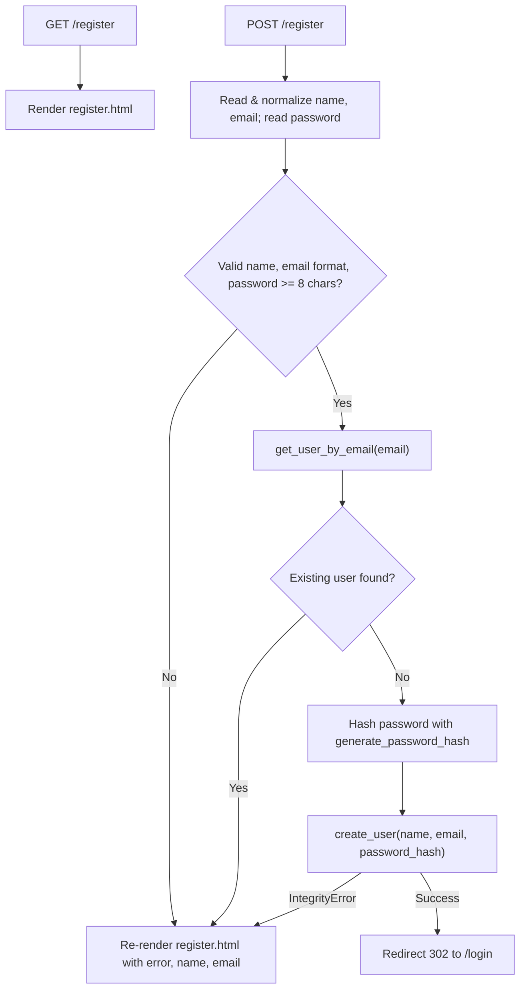

# Step 2 — Registration Implementation Plan

Based strictly on [.agents/specs/02-registration.md](file:///Users/arpitkushwaha/Documents/Github%20Projects/Agentic%20Coding%20/expense-tracker/.agents/specs/02-registration.md), [AGENTS.md](file:///Users/arpitkushwaha/Documents/Github%20Projects/Agentic%20Coding%20/expense-tracker/AGENTS.md), [app.py](file:///Users/arpitkushwaha/Documents/Github%20Projects/Agentic%20Coding%20/expense-tracker/app.py), [database/db.py](file:///Users/arpitkushwaha/Documents/Github%20Projects/Agentic%20Coding%20/expense-tracker/database/db.py), and [templates/register.html](file:///Users/arpitkushwaha/Documents/Github%20Projects/Agentic%20Coding%20/expense-tracker/templates/register.html).

## Goal Description

Implement user account registration across `GET /register` and `POST /register` so visitors can create an account with their full name, email address, and password. Form inputs will be validated server-side, email addresses normalized and checked for uniqueness, passwords hashed with Werkzeug (`generate_password_hash`), new users persisted to `spendly.db` via parameterized SQLite helpers in `database/db.py`, and successful registrations redirected to `/login`.

---

## Key Design Decisions & Edge Cases

1. **Email Normalization & Case-Insensitive Uniqueness**
   - SQLite's `email TEXT UNIQUE NOT NULL` constraint uses `BINARY` (case-sensitive) collation by default.
   - Both lookup (`get_user_by_email`) and insertion (`create_user`) will normalize emails with `.strip().lower()`, and the lookup query will compare using `LOWER(email) = ?` so emails like `DEMO@spendly.com` and `demo@spendly.com` are treated as the same account.
2. **Pre-check + `sqlite3.IntegrityError` Guard**
   - `POST /register` will check `get_user_by_email(email)` before hashing/inserting and also wrap `create_user(...)` in `try ... except sqlite3.IntegrityError` so concurrent/race-condition duplicate submissions still render a friendly `.auth-error` instead of a 500 error.
3. **Validation Rules (Matching `register.html` & `AGENTS.md`)**
   - `name`: stripped of leading/trailing whitespace; must be non-empty.
   - `email`: stripped and lowercased; must be non-empty and match a valid email format (`^[^@\s]+@[^@\s]+\.[^@\s]+$`).
   - `password`: must be at least 8 characters (matching `placeholder="Min. 8 characters"` in `templates/register.html`) and not purely whitespace. Do not strip leading/trailing spaces when hashing if the user intentionally included them alongside non-whitespace characters.
   - Never expose `password_hash` or pre-fill `password` on error re-renders.
4. **Redirect Target on Success**
   - On successful registration, redirect (`302`) to `url_for("login")`. Session login/logout is deferred to Step 3.
5. **Isolated Test Database**
   - `app.py` calls `init_db()` and `seed_db()` at import time against `database.db.DB_PATH`. In `tests/test_registration.py`, a pytest fixture will monkeypatch `database.db.DB_PATH` to a `tmp_path` SQLite file and run `init_db()` + `seed_db()` so tests never mutate the local `spendly.db`.

---

## Registration Request Flow

---

## Planned File Changes

### 1. Database Layer — [database/db.py](file:///Users/arpitkushwaha/Documents/Github%20Projects/Agentic%20Coding%20/expense-tracker/database/db.py)

Add a `# User Queries #` section (following the existing `# ---- #` divider style) with two parameterized helpers:

- **`get_user_by_email(email: str) -> sqlite3.Row | None`**
  - Normalize `email.strip().lower()`.
  - Open connection via `get_db()`, execute `SELECT id, name, email, password_hash, created_at FROM users WHERE LOWER(email) = ?` with `(normalized_email,)`, and return `.fetchone()`.
  - Close connection in a `try ... finally` block.
- **`create_user(name: str, email: str, password_hash: str) -> int`**
  - Normalize `name.strip()` and `email.strip().lower()`.
  - Open connection via `get_db()`, execute `INSERT INTO users (name, email, password_hash) VALUES (?, ?, ?)` with `(clean_name, normalized_email, password_hash)`, `conn.commit()`, and return `cursor.lastrowid`.
  - Close connection in a `try ... finally` block (allowing `sqlite3.IntegrityError` to propagate cleanly to the route handler).

No schema changes are needed; the existing `users` table in `init_db()` already has `id`, `name`, `email`, `password_hash`, and `created_at`.

---

### 2. Route Handler — [app.py](file:///Users/arpitkushwaha/Documents/Github%20Projects/Agentic%20Coding%20/expense-tracker/app.py)

Update imports and the `/register` route:

- **Imports:**
  - Standard library: `re`, `sqlite3`
  - Flask: `Flask, redirect, render_template, request, url_for`
  - Werkzeug: `from werkzeug.security import generate_password_hash`
  - Database: `from database.db import create_user, get_db, get_user_by_email, init_db, seed_db`
- **Email validation helper (e.g., `_is_valid_email(email: str) -> bool`):**
  - Compiled regex `^[^@\s]+@[^@\s]+\.[^@\s]+$` to validate normalized email strings.
- **`@app.route("/register", methods=["GET", "POST"])`:**
  - `GET`: render `templates/register.html`.
  - `POST`:
    1. Extract `name = request.form.get("name", "").strip()`, `email = request.form.get("email", "").strip().lower()`, and `password = request.form.get("password", "")`.
    2. Validate sequentially and return `render_template("register.html", error=..., name=name, email=email)` on first failure:
       - Empty `name` → `"Please enter your full name."`
       - Empty or invalid `email` → `"Please enter a valid email address."`
       - `len(password) < 8` or `not password.strip()` → `"Password must be at least 8 characters long."`
    3. Check `get_user_by_email(email)`: if a row exists, return `render_template("register.html", error="An account with this email already exists.", name=name, email=email)`.
    4. Compute `password_hash = generate_password_hash(password)` and call `create_user(name, email, password_hash)` inside `try ... except sqlite3.IntegrityError`; on `IntegrityError`, return the duplicate-email error render.
    5. Return `redirect(url_for("login"))`.

All other routes (`/`, `/login`, `/terms`, `/privacy`, and placeholder routes for Steps 3–9) remain unchanged.

---

### 3. Template — [templates/register.html](file:///Users/arpitkushwaha/Documents/Github%20Projects/Agentic%20Coding%20/expense-tracker/templates/register.html)

Make minimal targeted updates while keeping `` and existing CSS classes intact:

- Update `<form method="POST" action="{{ url_for('register') }}">` (resolves to `/register`).
- Add `value="{{ name | default('') }}"` to `#name` input.
- Add `value="{{ email | default('') }}"` to `#email` input.
- Leave `#password` input without a `value` attribute so passwords are never echoed back.
- Keep `
{{ error }}
` unchanged.
- No CSS or JS files need changes; `.auth-error` and form styles are already defined with CSS variables in [static/css/style.css](file:///Users/arpitkushwaha/Documents/Github%20Projects/Agentic%20Coding%20/expense-tracker/static/css/style.css).

---

### 4. Automated Tests — `tests/test_registration.py` (New File)

Create `tests/test_registration.py` using `pytest`:

- **Fixture (`client`)**:
  - Monkeypatch `database.db.DB_PATH` to `str(tmp_path / "test_spendly.db")`.
  - Call `init_db()` and `seed_db()`.
  - Configure `app.config["TESTING"] = True` and yield `app.test_client()`.
- **Test cases**:
  1. `test_get_register_renders_form`: `GET /register` returns `200`, contains registration heading and `name`, `email`, `password` inputs.
  2. `test_post_register_success`: valid `name`, mixed-case/padded `email`, and `>= 8` char `password` redirects (`302`) to `/login`; DB contains 1 new user with trimmed name, lowercase email, and a Werkzeug hash matching `check_password_hash` (not plaintext).
  3. `test_post_register_blank_name`: blank/whitespace `name` does not insert a user, renders `.auth-error`, and preserves `email`.
  4. `test_post_register_invalid_email`: empty or malformed email (`"invalid"`, `"user@domain"`) does not insert a user, renders `.auth-error`, and preserves `name`/`email`.
  5. `test_post_register_short_or_blank_password`: `< 8` char password or whitespace-only password does not insert a user, renders `.auth-error`, preserves `name`/`email`, and leaves `password` input empty.
  6. `test_post_register_duplicate_email_case_insensitive`: registering with `demo@spendly.com` or `DEMO@spendly.com` does not create a duplicate row, renders `.auth-error`, and preserves `name`/`email`.
  7. `test_post_register_handles_integrity_error`: monkeypatching `get_user_by_email` to return `None` while submitting an existing email triggers `sqlite3.IntegrityError` in `create_user` and verifies the route renders `.auth-error` rather than crashing.

---

## Verification Plan

After implementation:

1. **Automated test suite**:
   - Run `.venv/bin/pytest` and confirm all tests in `tests/test_registration.py` pass with 0 failures or skipped assertions.
2. **Regression & lint/syntax check**:
   - Verify existing public routes (`/`, `/login`, `/terms`, `/privacy`) still return `200` via Flask test client or pytest.
3. **Manual smoke test (optional local server check)**:
   - Run `.venv/bin/python app.py`, visit `http://127.0.0.1:5001/register`, test invalid input error rendering and a valid account registration redirecting to `/login`, then verify the new user row in `spendly.db` has a hashed `password_hash`.
